<p align="center">
  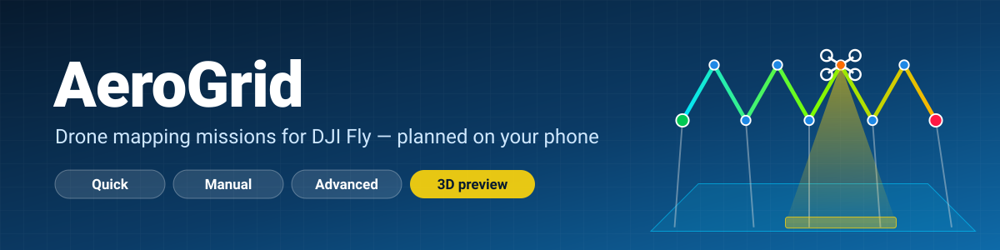
</p>

<p align="center">
  
  
  
  
  
  
</p>

<p align="center">
  <b>Draw an area. Get a mapping grid. Fly it with DJI Fly.</b><br>
  A native Android planner for photogrammetry and orthomosaic missions on the <b>DJI Mini 5 Pro</b>,<br>
  with live overlap checks, a 3D preview of the flight and a safe hand-off into DJI Fly.
</p>

<p align="center">
  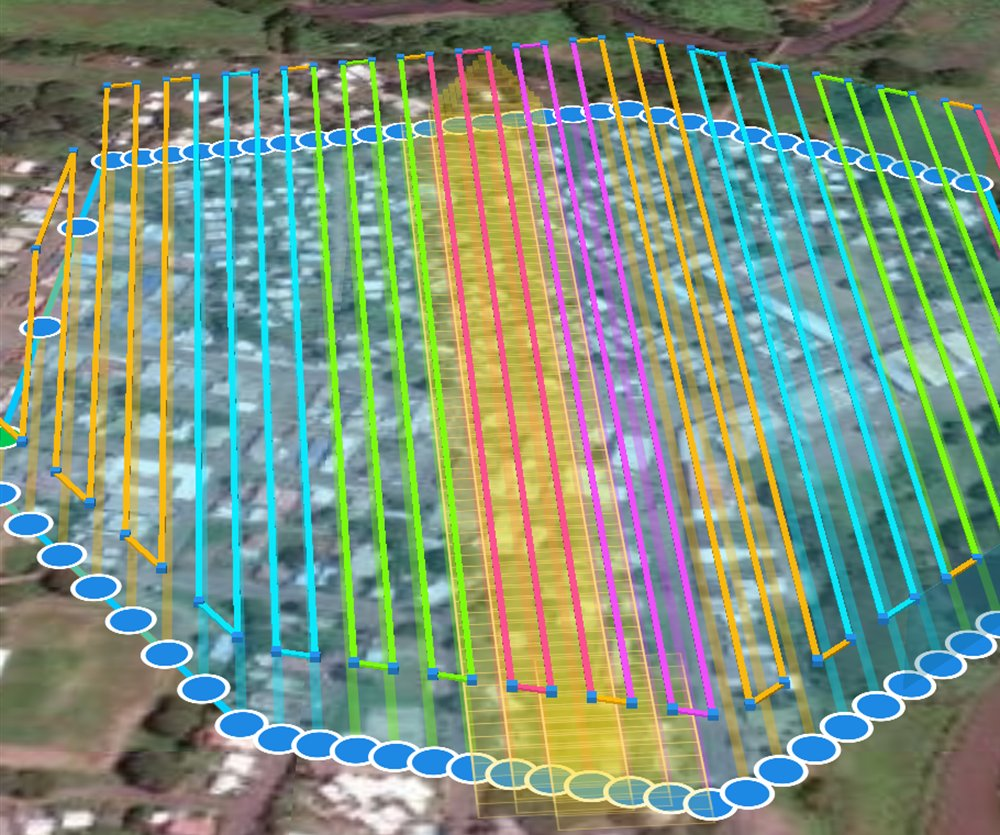
  <br><sub>3D view over Tavua, Fiji — the grid floats at flight height, pillars drop to the ground, and the yellow column is the camera's field of view showing photo overlap.</sub>
</p>

---

## ✈️ Three ways to plan

| ⚡ **Quick** | 📍 **Manual** | 🛠️ **Advanced** |
|:---:|:---:|:---:|
| 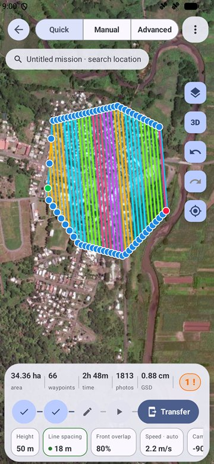 | 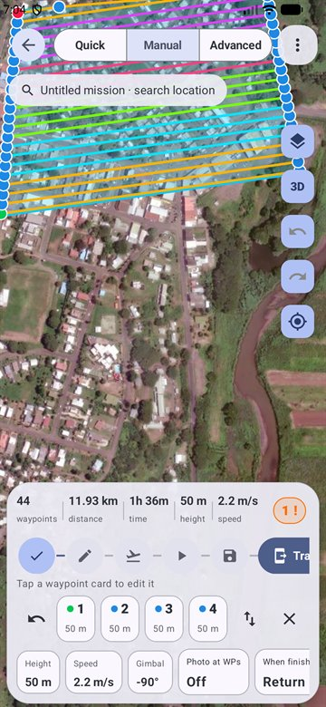 | 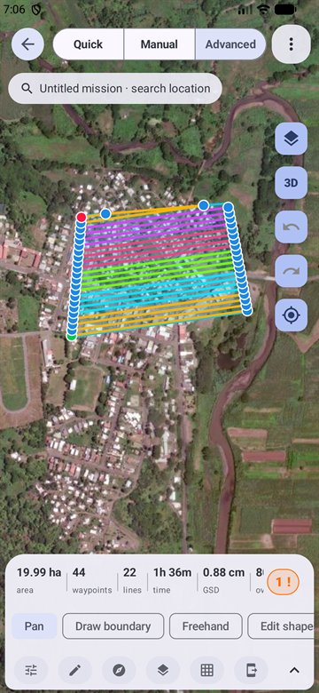 |
| Draw a boundary, tap **Generate**, transfer. Height, line spacing, overlap and speed sit on one-tap chips — everything else is automatic. | Plot your own waypoints by tapping the map, tune each one (height, speed, gimbal, heading, actions), save a DJI-compatible KMZ. | Every parameter: patterns, exclusion zones, corridors, terrain, camera sensor, waypoint table, mission blocks and all export formats. |

All three modes edit **the same mission** — switch at any time without losing a single waypoint or height override.

## 🧭 From boundary to DJI Fly

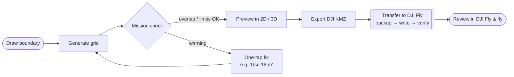

## 📸 Tour

<table>
  <tr>
    <td align="center">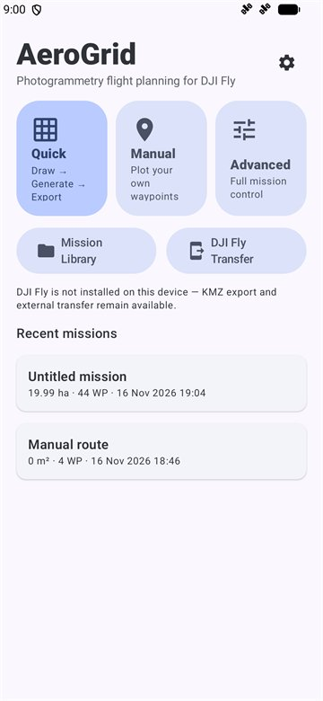<br><sub><b>Dashboard</b><br>pick a mode or a recent mission</sub></td>
    <td align="center">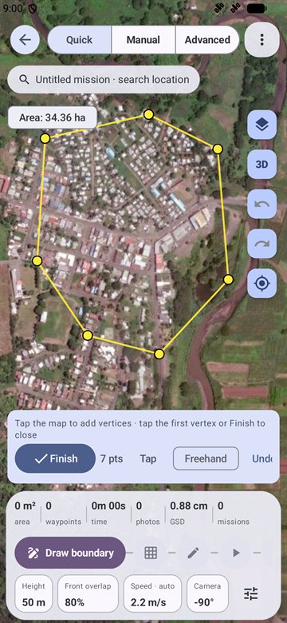<br><sub><b>Draw</b><br>tap or freehand, live area</sub></td>
    <td align="center"><br><sub><b>Generate</b><br>optimised lawnmower grid</sub></td>
    <td align="center">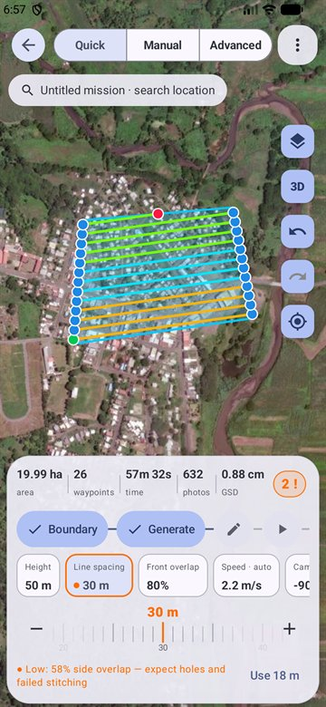<br><sub><b>Smart spacing</b><br>overlap rating + one-tap fix</sub></td>
  </tr>
  <tr>
    <td align="center">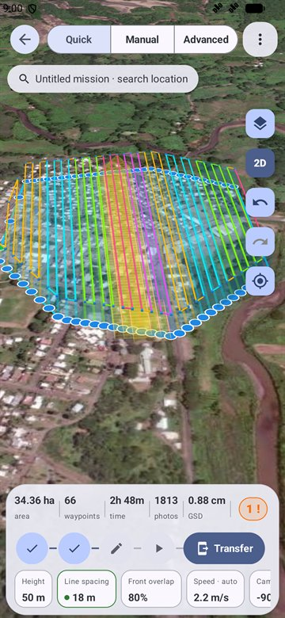<br><sub><b>3D view</b><br>route at real height</sub></td>
    <td align="center">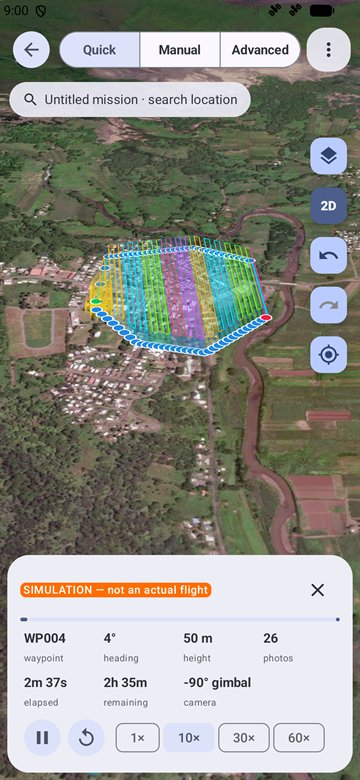<br><sub><b>Flight preview</b><br>simulated drone & photos</sub></td>
    <td align="center">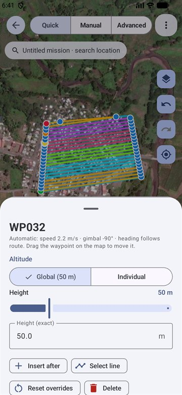<br><sub><b>Edit a waypoint</b><br>individual heights kept</sub></td>
    <td align="center">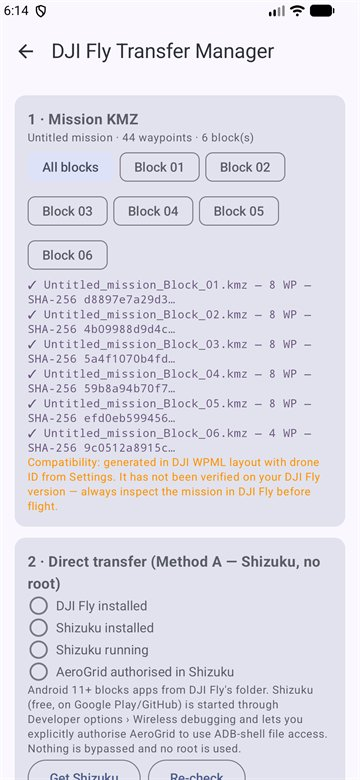<br><sub><b>Transfer</b><br>validated KMZ per mission block</sub></td>
  </tr>
</table>

## ✨ Highlights

**Planning that thinks about the photos**
- 📐 Real photogrammetry maths for the DJI Mini 5 Pro (1″ 50 MP, 84° DFOV, 4:3): footprint, GSD, photo & line spacing, required speed for your overlap.
- 🎚️ **Line spacing** in metres with a live rating — 🟢 good · 🟡 acceptable · 🟠 low · 🔴 gaps — and a one-tap "use recommended" fix.
- 🧩 Grids clip to any concave boundary, route **around** exclusion zones (never through them), and split automatically into battery-sized missions under the 200-waypoint limit.
- 🏔️ Optional terrain from SRTM `.hgt` / ESRI `.asc` DEMs: per-waypoint heights for true above-ground altitude, terrain profile and clearance warnings.

**A map-first interface**
- 🗺️ Satellite, street and hybrid maps (MapLibre), offline street maps, location search, GPS.
- 🧊 **3D view** — elevated route ribbons, waypoint pillars, boundary walls, the camera's field-of-view pyramid and overlapping ground footprints.
- 🎛️ **Mission dock** — stat strip with an issues badge, a workflow rail that highlights your next step, and parameter chips with a drag-to-scrub ruler and haptic ticks.
- ↩️ Undo/redo everything, drag waypoints and vertices, multi-select and batch edit.

**Getting it into DJI Fly**
- 📦 Generates DJI WPML missions (`wpmz/template.kml` + `wpmz/waylines.wpml`) and validates every file before export.
- 🔁 **Transfer Manager** — with [Shizuku](https://shizuku.rikka.app/) (no root) it backs up your DJI Fly placeholder, writes the mission, verifies the SHA-256 and restores the original automatically if anything fails.
- 📤 Or save to Downloads / share, or use the included Windows script ([`tools/djifly_transfer.ps1`](tools/djifly_transfer.ps1)) over USB.
- 📄 Also exports KML, GeoJSON, GPX, CSV, PNG and a PDF mission summary; imports KML/KMZ/GeoJSON/GPX and existing DJI missions.

## 📲 Install

1. Open the latest **[Release](../../releases/latest)** on your phone and download `AeroGrid.apk`.
2. Open it and allow installs from your browser or Files app.
3. *(Optional, for direct transfer)* install **Shizuku**, start it via *Developer options › Wireless debugging*, then authorise AeroGrid in the Transfer Manager.

> [!WARNING]
> **Check every mission in DJI Fly before flight.** The KMZ format is not officially documented by DJI and AeroGrid has not yet been verified on every DJI Fly version. The aircraft ID defaults to `68 / 0` (community-observed); import a mission saved by your own DJI Fly under **Settings › Import DJI Fly reference KMZ** to copy the exact values. Timed photos must be started manually in DJI Fly. Routes are **not** guaranteed collision-free — you are responsible for airspace rules, obstacles and terrain.

## 🛠️ Build from source

Requires **JDK 17+** and an Android SDK with **platform 36** (`sdk.dir` in `local.properties`).

```bash
./gradlew :app:testDebugUnitTest          # 44 JVM tests
./gradlew :app:connectedDebugAndroidTest  # Room persistence test (device/emulator)
./gradlew :app:assembleRelease            # app/build/outputs/apk/release/app-release.apk
```

Release signing reads `keystore.properties` from the project root (never committed). Without it the release APK is built unsigned.

```properties
storeFile=app/your-key.jks
storePassword=…
keyAlias=…
keyPassword=…
```

## 🧱 How it's built

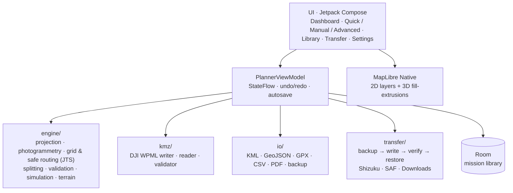

| Layer | Tech |
|---|---|
| Language & UI | Kotlin 2.0, Jetpack Compose, Material 3 (dynamic colour, light/dark) |
| Maps | MapLibre Native 11 — OpenFreeMap streets, Esri World Imagery, offline regions |
| Geometry | JTS Topology Suite — clipping, buffering, visibility-graph routing |
| Storage | Room + kotlinx.serialization |
| DJI transfer | Shizuku API, Storage Access Framework, MediaStore |
| Build | Gradle 8.13, AGP 8.13, R8 shrinking (25 MB APK, arm64 + x86_64) |

<details>
<summary><b>📁 Project layout</b></summary>

```
app/src/main/java/com/aerogrid/app/
├── engine/     Local projection, photogrammetry, RoutePlanner, splitting, validation, simulation, terrain
├── kmz/        DJI WPML writer, reader and validator
├── io/         KML/KMZ/GeoJSON/GPX/CSV import/export, PDF/PNG reports, backups
├── transfer/   TransferEngine + Shizuku, SAF and Downloads implementations
├── data/       Room database, repository, settings
└── ui/         Compose screens, mission dock, MapController, 3D scene builder
app/src/test/   44 unit tests (geometry, grids, exclusions, overlap, WPML, formats, transfer recovery, terrain)
tools/          djifly_transfer.ps1 — USB placeholder replacement with backup + hash check
```
</details>

## 🙏 Credits

Map data © [OpenStreetMap](https://www.openstreetmap.org/copyright) contributors via [OpenFreeMap](https://openfreemap.org/) · Imagery © Esri, Maxar, Earthstar Geographics · Built with [MapLibre Native](https://maplibre.org/), [JTS](https://github.com/locationtech/jts) and [Shizuku](https://github.com/RikkaApps/Shizuku). DJI, DJI Fly and DJI Mini are trademarks of SZ DJI Technology Co., Ltd.; AeroGrid is an independent project and is not affiliated with DJI.
